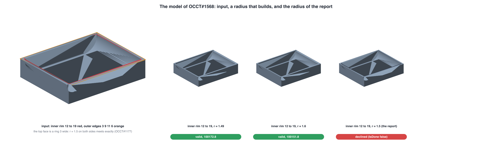
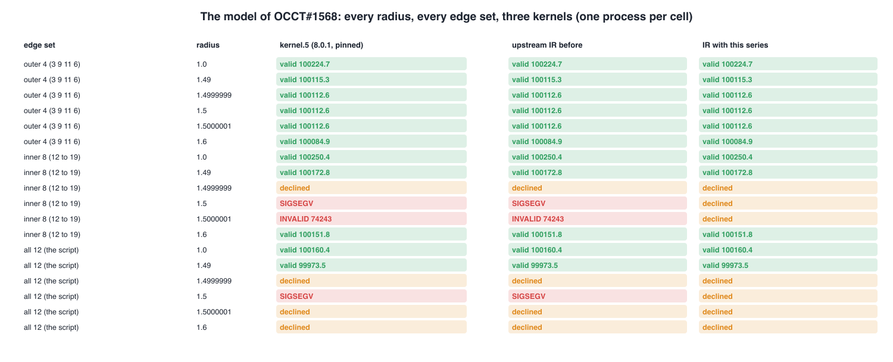
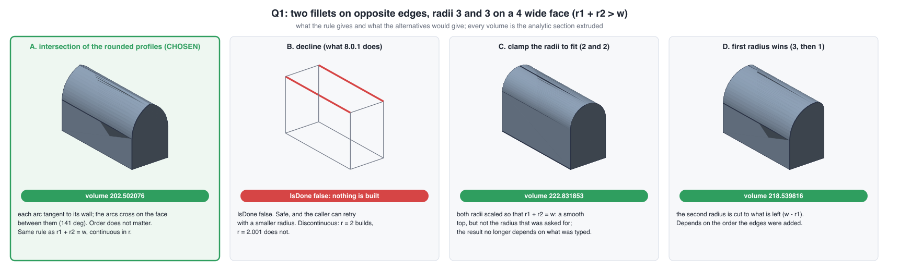
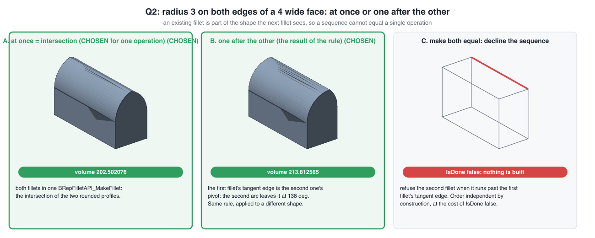
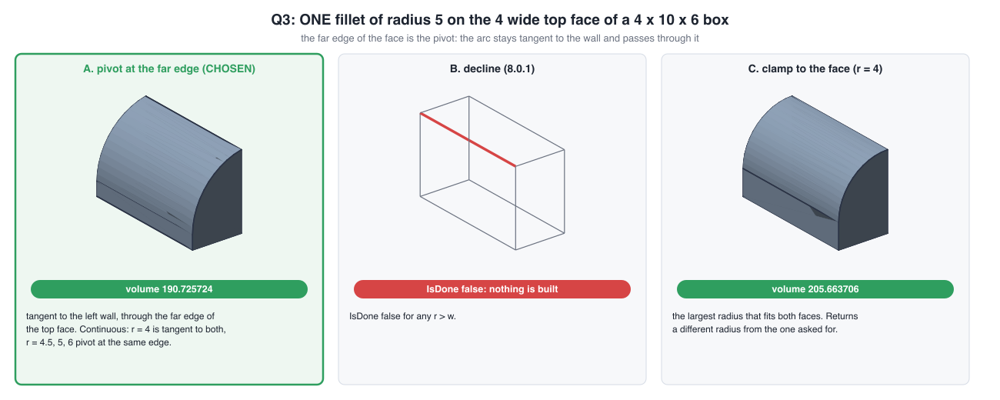
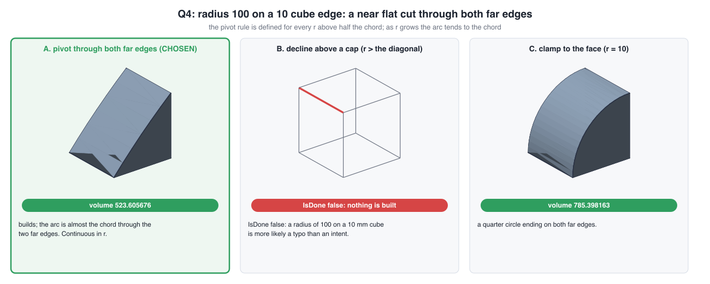
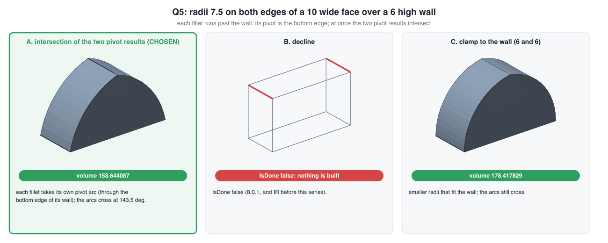
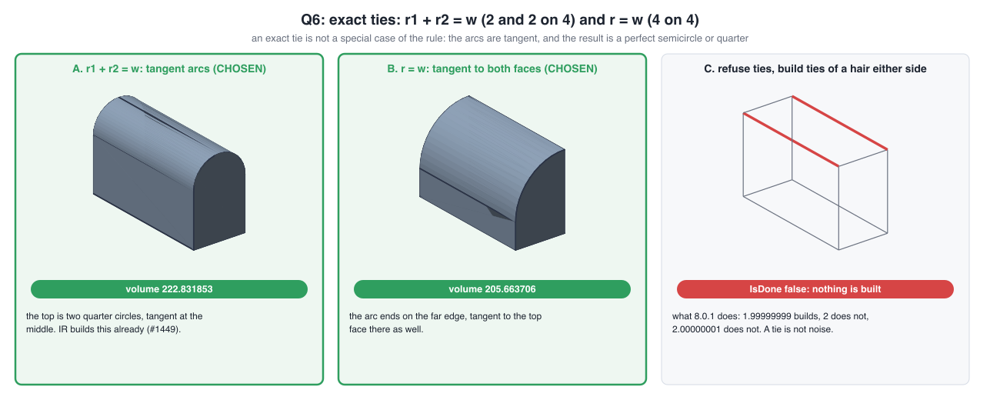

# The opposite-edge fillet family (OCCT#1568, #1177): break, fix, decisions and alternatives

Nothing here is posted anywhere. Target branch is upstream `IR`; the integration branch is
`integration/ir-fillet-1568` in the local OCCT checkout (`/Users/elb/Projects/worktrees/occt-ir-fillet-1568`, five commits
on top of `23d68aeb9`). The series as patches: `Scripts/repro/occt1568-opposite-edge-family/upstream/`. Drafts of the PR
description, the FreeCAD#25289 comment and the Discussion note are in `drafts/`.

## One page

| # | what | 8.0.1 (kernel.5) | upstream IR, before | IR with the series |
| --- | --- | --- | --- | --- |
| 1 | `StartSol` leaves an empty adaptor: the model of #1568 at r = 1.5 | SIGSEGV | SIGSEGV | IsDone false (clean) |
| 2 | opposite fillets, r1 + r2 > w (a 4 mm face, 3 and 3) | IsDone false | **done, INVALID, volume 315.7 for a box of 240** | valid, 202.502076 = analytic |
| 3 | one fillet r > w (r = 5 on 4) | IsDone false | IsDone false | valid, pivot at the far edge, 190.725724 = analytic |
| 4 | r1 + r2 = w exactly (2, 2) | IsDone false | valid (upstream #1449) | valid, unchanged |
| 5 | r1 + r2 = w + 1e-9 .. 1e-5 | IsDone false | **done, INVALID (333, 256)** | valid (intersection) or declined, never invalid |
| 6 | a second fillet that meets a finished one exactly (5 after 5 on 10) | n/a | **done, INVALID** | valid, 197.079633 |
| 7 | the model, inner rim at r = 1.5000001 | done, INVALID 74243 | done, INVALID 74243 | IsDone false |

Rows 2, 5, 6 and 7 are defects of IR itself (rows 2 and 5 are a regression from 8.0.1, which refused them): `IsDone()`
true with a shape BRepCheck rejects.

Images: every case has one with four panels: the analytic section (dashed blue) with the pivots and tangent points, upstream IR
before the series (an invalid solid is drawn orange, a refusal is the input with the filleted edges red), IR with the
series, and the reference (the section extruded: what a sketch and an extrude gives in Shapr3D). The recipes below each
image give the Shapr3D steps.

## The model of #1568 (the break and what the fix does)

Read it as: the crash is gone (rows `1.5` of the inner rim and of all 12 are SIGSEGV on 8.0.1 and IR, declined with the
series). The report asked for "completing the fillet meeting the opposite edge". That does **not** happen for this
model: at r = 1.5 the inner rim is declined, 1.49 and 1.6 build (valid), and the four outer edges 3 9 11 6 together
with the rim stay declined at 1.5 and 1.6 because the outer edges share corners (a different piece of the blend code,
#3233). The top face of this model is a ring 3 mm wide, so r = 1.5 on the rim and on the outer edge is the exact
meeting r = w/2 of #1177 as well. Edges 12 to 19 form one contour; the reporter's twelve edges are that contour plus the
four outer top edges.

Edge by edge (r = 1.5, `Scripts/repro/occt1568-opposite-edge-family/brepfillet.cxx`): 3, 9, 11, 6 each alone build
(valid); 13 to 19 and 12 each alone are the same contour and are declined.

## Decisions: the chosen behaviour and the alternatives, each drawn

The rule that chooses: where a fillet meets a face it is filleting it is tangent to that face; where the face runs out
the edge is the pivot. Each figure shows the analytic result of each alternative, with its volume.

| decision | chosen | alternatives | image |
| --- | --- | --- | --- |
| Q1 radii past the face between two opposite edges (3, 3 on 4) | intersection of the rounded profiles, 202.502076 | decline (8.0.1); clamp to r1 + r2 = w (222.83); first radius wins (218.54) | `Q1-opposite-radii-past-the-face.png` |
| Q2 order: at once or one after the other | at once = intersection; one after the other = the same rule on the shape the second fillet sees, 213.812565 | decline the second fillet when it runs past the first one's tangent edge | `Q2-order-dependence.png` |
| Q3 one fillet wider than its face (5 on 4) | pivot at the far edge, 190.725724 | decline; clamp to w (205.66) | `Q3-single-radius-past-the-face.png` |
| Q4 a huge radius (100 on a 10 cube) | the same rule: a near flat cut, 523.605676 | decline above a cap; clamp to the face (785.40) | `Q4-huge-radius.png` |
| Q5 both radii past their wall (7.5, 7.5 on 10 wide over 6 high) | intersection of the two pivot results, 153.644087 | decline; clamp to the wall | `Q5-both-past-their-wall.png` |
| Q6 exact ties (2, 2 on 4; 4 on 4) | tangent arcs, no special case | refuse ties (8.0.1) | `Q6-exact-ties.png` |
| Q7 an invalid result | a failure (commit 5, one BRepCheck run per fillet, a third of the fillet time on the 19 face model) | leave validation to the caller (the OCCTSwift bridge does: #3200) | no image |

## Numbers

- GTest, whole suite on IR plus the series: 8365 passed, 7 skipped, 0 failed (8352 before the series, the 7 skips are
  upstream's). TKFillet's 41 tests pass.
- Prove the test fails: each new test was run against the tree without its change and fails there (commit 1: the
  process dies; 2: three tests with volumes above the box's; 3: the fillet tests; 4: four tests; 5: two tests).
- 715 box cases (10 configurations, radii around the critical value, `add`, `add2` and sequential), one process per
  case, IR against IR with the series (`battery-IR-vs-series.tsv`): 338 valid and identical (volume 1e-9, face count),
  254 unchanged (250 refusals, 4 time outs, see below), 56 now valid (22 refusals, 34 invalid solids), 64 invalid solids
  no longer reported done, 3 uncaught exceptions now IsDone false, **0 regressed, 0 newly invalid, 0 invalid solids
  remain**.
- The same against the released kernel.5 (`battery-kernel5-vs-series.tsv`): 296 valid in both (294 identical, 2 differ by
  3e-5 in volume at r = w - 1e-8 in a sequence: both valid, and IR before the series gives the same number, so that is
  upstream IR against 8.0.1, not the series), 98 refusals now valid, 42 invalid solids of 8.0.1 now declined, 275
  refusals unchanged, 4 refusals that are now a time out on IR (see below).
- **A hang on IR itself**: four fillets round a 4 x 4 face of a 4 x 4 x 4 cube at r = 2 (and 2 - 1 ulp), `add` and `add2`:
  more than 90 s (killed) on IR before and with the series; 8.0.1 answers IsDone false at once. Not caused by the series
  and not fixed by it. It is a frame (#3233 territory) that consumes the whole face.
- Oracle (`validate.tsv`, `oracle.py`): 38 cases, 20 with crease checks, 0 failed, worst relative volume error
  1.9e-11, tangency to the walls 0.00 degrees, closed, one solid, tessellates, deterministic over three runs.
- Build: Release, `BUILD_MODULE_ModelingAlgorithms` + data + foundation, GTest on, local, Apple clang, 10 cores.
- Not run: DRAW tests (`tests/blend`, `bug25478_*`, `bug119`): the Draw module is not in this build.

## Where the series stops

- The model of #1568 stays declined at r = 1.5 (see above).
- Contours that share a vertex (adjacent edges, frames, corners: #3233, patch candidate 0061), curved or non-rectangular
  faces and other dihedral angles (#3234, 0062), chamfers (#3297, #3300, 0063), history (`Modified`, `Generated`: #3236),
  and the data-structure fix (#3235) are NOT in this series.
- Adjacent fillets at r = w are declined by commit 5 where IR returned an invalid solid (C4 and C6 in the battery).

## OCCTSwift side

The kernel is pinned to 8.0.1 plus carried patches, and 8.0.1 refuses everything the series builds, so the commits that
repair IR's regression (2 and 5) do not apply to it. What the pinned kernel needs for these cases is already the
candidate patches 0054 and 0059 (on main) and 0060 (branch `fix/fillet-pivot-edges`, `Issue3208FilletPivotTests`).
No new patch number is needed for this series.

## A: r1 + r2 = w

### A: r1 + r2 = w, radii 1.5 and 2.5 on the top edges of a 4 x 10 x 6 box

File `A-1_5-2_5.png`. Box 4 x 10 x 6 (X x Y x Z), one corner at the origin, top face Z = 6. Fillets: radius 1.5 on the edge whose middle is (0, 5, 6); radius 2.5 on the edge whose middle is (4, 5, 6), all in one operation.

Shapr3D, construction: sketch on the XZ plane (the front plane, looking along Y) with the origin at the box's lower-left corner, one closed profile, extrude 10 along +Y:

1. Start at (0.0000, 0.0000).
2. Line to (0.0000, 4.5000).
3. Arc, centre (1.5000, 4.5000), radius 1.5, from (0.0000, 4.5000) to (1.5000, 6.0000), the short way round (it bulges towards the corner it rounds).
4. Arc, centre (1.5000, 3.5000), radius 2.5, from (1.5000, 6.0000) to (4.0000, 3.5000), the short way round (it bulges towards the corner it rounds).
5. Line to (4.0000, 0.0000).
6. Close the profile back to the start with a line, then extrude 10.

Expected: the arcs are tangent to each other at the junction (180 deg).

Check against the fillet tool: apply the same radii to the same edges of a plain box and compare the profile with the sketch above; they should coincide. Volume 221.758844 (the profile area is 22.175884).

Kernel results: pinned kernel.5 declined; IR before valid 221.758844; IR with this series valid 221.758844; reference extrusion valid 221.758844.

### A: r1 + r2 = w, radii 1 and 3 on the top edges of a 4 x 10 x 6 box

File `A-1-3.png`. Box 4 x 10 x 6 (X x Y x Z), one corner at the origin, top face Z = 6. Fillets: radius 1 on the edge whose middle is (0, 5, 6); radius 3 on the edge whose middle is (4, 5, 6), all in one operation.

Shapr3D, construction: sketch on the XZ plane (the front plane, looking along Y) with the origin at the box's lower-left corner, one closed profile, extrude 10 along +Y:

1. Start at (0.0000, 0.0000).
2. Line to (0.0000, 5.0000).
3. Arc, centre (1.0000, 5.0000), radius 1, from (0.0000, 5.0000) to (1.0000, 6.0000), the short way round (it bulges towards the corner it rounds).
4. Arc, centre (1.0000, 3.0000), radius 3, from (1.0000, 6.0000) to (4.0000, 3.0000), the short way round (it bulges towards the corner it rounds).
5. Line to (4.0000, 0.0000).
6. Close the profile back to the start with a line, then extrude 10.

Expected: the arcs are tangent to each other at the junction (180 deg).

Check against the fillet tool: apply the same radii to the same edges of a plain box and compare the profile with the sketch above; they should coincide. Volume 218.539816 (the profile area is 21.853982).

Kernel results: pinned kernel.5 declined; IR before valid 218.539816; IR with this series valid 218.539816; reference extrusion valid 218.539816.

### A: r1 + r2 = w, radii 2 and 2 on the top edges of a 4 x 10 x 6 box

File `A-2-2.png`. Box 4 x 10 x 6 (X x Y x Z), one corner at the origin, top face Z = 6. Fillets: radius 2 on the edge whose middle is (0, 5, 6); radius 2 on the edge whose middle is (4, 5, 6), all in one operation.

Shapr3D, construction: sketch on the XZ plane (the front plane, looking along Y) with the origin at the box's lower-left corner, one closed profile, extrude 10 along +Y:

1. Start at (0.0000, 0.0000).
2. Line to (0.0000, 4.0000).
3. Arc, centre (2.0000, 4.0000), radius 2, from (0.0000, 4.0000) to (2.0000, 6.0000), the short way round (it bulges towards the corner it rounds).
4. Arc, centre (2.0000, 4.0000), radius 2, from (2.0000, 6.0000) to (4.0000, 4.0000), the short way round (it bulges towards the corner it rounds).
5. Line to (4.0000, 0.0000).
6. Close the profile back to the start with a line, then extrude 10.

Expected: the arcs are tangent to each other at the junction (180 deg).

Check against the fillet tool: apply the same radii to the same edges of a plain box and compare the profile with the sketch above; they should coincide. Volume 222.831853 (the profile area is 22.283185).

Kernel results: pinned kernel.5 declined; IR before valid 222.831853; IR with this series valid 222.831853; reference extrusion valid 222.831853.

## B: r1 + r2 > w

### B: r1 + r2 > w, equal radii 2.2 on the top edges of a 4 x 10 x 6 box

File `B-equal-2_2.png`. Box 4 x 10 x 6 (X x Y x Z), one corner at the origin, top face Z = 6. Fillets: radius 2.2 on the edge whose middle is (0, 5, 6); radius 2.2 on the edge whose middle is (4, 5, 6), all in one operation.

Shapr3D, construction: sketch on the XZ plane (the front plane, looking along Y) with the origin at the box's lower-left corner, one closed profile, extrude 10 along +Y:

1. Start at (0.0000, 0.0000).
2. Line to (0.0000, 3.8000).
3. Arc, centre (2.2000, 3.8000), radius 2.2, from (0.0000, 3.8000) to (2.0000, 5.9909), the short way round (it bulges towards the corner it rounds).
4. Arc, centre (1.8000, 3.8000), radius 2.2, from (2.0000, 5.9909) to (4.0000, 3.8000), the short way round (it bulges towards the corner it rounds).
5. Line to (4.0000, 0.0000).
6. Close the profile back to the start with a line, then extrude 10.

Expected: the arcs cross; 169.57 deg between them (included, through the material).

Check against the fillet tool: apply the same radii to the same edges of a plain box and compare the profile with the sketch above; they should coincide. Volume 219.238679 (the profile area is 21.923868).

Kernel results: pinned kernel.5 declined; IR before INVALID 330.465; IR with this series valid 219.238678; reference extrusion valid 219.238678.

### B: r1 + r2 > w, equal radii 2.5 on the top edges of a 4 x 10 x 6 box

File `B-equal-2_5.png`. Box 4 x 10 x 6 (X x Y x Z), one corner at the origin, top face Z = 6. Fillets: radius 2.5 on the edge whose middle is (0, 5, 6); radius 2.5 on the edge whose middle is (4, 5, 6), all in one operation.

Shapr3D, construction: sketch on the XZ plane (the front plane, looking along Y) with the origin at the box's lower-left corner, one closed profile, extrude 10 along +Y:

1. Start at (0.0000, 0.0000).
2. Line to (0.0000, 3.5000).
3. Arc, centre (2.5000, 3.5000), radius 2.5, from (0.0000, 3.5000) to (2.0000, 5.9495), the short way round (it bulges towards the corner it rounds).
4. Arc, centre (1.5000, 3.5000), radius 2.5, from (2.0000, 5.9495) to (4.0000, 3.5000), the short way round (it bulges towards the corner it rounds).
5. Line to (4.0000, 0.0000).
6. Close the profile back to the start with a line, then extrude 10.

Expected: the arcs cross; 156.93 deg between them (included, through the material).

Check against the fillet tool: apply the same radii to the same edges of a plain box and compare the profile with the sketch above; they should coincide. Volume 213.342452 (the profile area is 21.334245).

Kernel results: pinned kernel.5 declined; IR before INVALID 325.556; IR with this series valid 213.342452; reference extrusion valid 213.342452.

### B: r1 + r2 > w, equal radii 3 on the top edges of a 4 x 10 x 6 box

File `B-equal-3.png`. Box 4 x 10 x 6 (X x Y x Z), one corner at the origin, top face Z = 6. Fillets: radius 3 on the edge whose middle is (0, 5, 6); radius 3 on the edge whose middle is (4, 5, 6), all in one operation.

Shapr3D, construction: sketch on the XZ plane (the front plane, looking along Y) with the origin at the box's lower-left corner, one closed profile, extrude 10 along +Y:

1. Start at (0.0000, 0.0000).
2. Line to (0.0000, 3.0000).
3. Arc, centre (3.0000, 3.0000), radius 3, from (0.0000, 3.0000) to (2.0000, 5.8284), the short way round (it bulges towards the corner it rounds).
4. Arc, centre (1.0000, 3.0000), radius 3, from (2.0000, 5.8284) to (4.0000, 3.0000), the short way round (it bulges towards the corner it rounds).
5. Line to (4.0000, 0.0000).
6. Close the profile back to the start with a line, then extrude 10.

Expected: the arcs cross; 141.06 deg between them (included, through the material).

Check against the fillet tool: apply the same radii to the same edges of a plain box and compare the profile with the sketch above; they should coincide. Volume 202.502076 (the profile area is 20.250208).

Kernel results: pinned kernel.5 declined; IR before INVALID 315.657; IR with this series valid 202.502076; reference extrusion valid 202.502076.

### B: r1 + r2 > w, equal radii 3.5 on the top edges of a 4 x 10 x 6 box

File `B-equal-3_5.png`. Box 4 x 10 x 6 (X x Y x Z), one corner at the origin, top face Z = 6. Fillets: radius 3.5 on the edge whose middle is (0, 5, 6); radius 3.5 on the edge whose middle is (4, 5, 6), all in one operation.

Shapr3D, construction: sketch on the XZ plane (the front plane, looking along Y) with the origin at the box's lower-left corner, one closed profile, extrude 10 along +Y:

1. Start at (0.0000, 0.0000).
2. Line to (0.0000, 2.5000).
3. Arc, centre (3.5000, 2.5000), radius 3.5, from (0.0000, 2.5000) to (2.0000, 5.6623), the short way round (it bulges towards the corner it rounds).
4. Arc, centre (0.5000, 2.5000), radius 3.5, from (2.0000, 5.6623) to (4.0000, 2.5000), the short way round (it bulges towards the corner it rounds).
5. Line to (4.0000, 0.0000).
6. Close the profile back to the start with a line, then extrude 10.

Expected: the arcs cross; 129.25 deg between them (included, through the material).

Check against the fillet tool: apply the same radii to the same edges of a plain box and compare the profile with the sketch above; they should coincide. Volume 190.731782 (the profile area is 19.073178).

Kernel results: pinned kernel.5 declined; IR before INVALID 303.613; IR with this series valid 190.731782; reference extrusion valid 190.731782.

### B: r1 + r2 > w, equal radii 3.9 on the top edges of a 4 x 10 x 6 box

File `B-equal-3_9.png`. Box 4 x 10 x 6 (X x Y x Z), one corner at the origin, top face Z = 6. Fillets: radius 3.9 on the edge whose middle is (0, 5, 6); radius 3.9 on the edge whose middle is (4, 5, 6), all in one operation.

Shapr3D, construction: sketch on the XZ plane (the front plane, looking along Y) with the origin at the box's lower-left corner, one closed profile, extrude 10 along +Y:

1. Start at (0.0000, 0.0000).
2. Line to (0.0000, 2.1000).
3. Arc, centre (3.9000, 2.1000), radius 3.9, from (0.0000, 2.1000) to (2.0000, 5.5059), the short way round (it bulges towards the corner it rounds).
4. Arc, centre (0.1000, 2.1000), radius 3.9, from (2.0000, 5.5059) to (4.0000, 2.1000), the short way round (it bulges towards the corner it rounds).
5. Line to (4.0000, 0.0000).
6. Close the profile back to the start with a line, then extrude 10.

Expected: the arcs cross; 121.69 deg between them (included, through the material).

Check against the fillet tool: apply the same radii to the same edges of a plain box and compare the profile with the sketch above; they should coincide. Volume 180.809285 (the profile area is 18.080928).

Kernel results: pinned kernel.5 declined; IR before INVALID 292.432; IR with this series valid 180.809285; reference extrusion valid 180.809285.

### B: r1 + r2 > w, radii 2 and 2.5 on the top edges of a 4 x 10 x 6 box

File `B-unequal-2-2_5.png`. Box 4 x 10 x 6 (X x Y x Z), one corner at the origin, top face Z = 6. Fillets: radius 2 on the edge whose middle is (0, 5, 6); radius 2.5 on the edge whose middle is (4, 5, 6), all in one operation.

Shapr3D, construction: sketch on the XZ plane (the front plane, looking along Y) with the origin at the box's lower-left corner, one closed profile, extrude 10 along +Y:

1. Start at (0.0000, 0.0000).
2. Line to (0.0000, 4.0000).
3. Arc, centre (2.0000, 4.0000), radius 2, from (0.0000, 4.0000) to (1.7640, 5.9860), the short way round (it bulges towards the corner it rounds).
4. Arc, centre (1.5000, 3.5000), radius 2.5, from (1.7640, 5.9860) to (4.0000, 3.5000), the short way round (it bulges towards the corner it rounds).
5. Line to (4.0000, 0.0000).
6. Close the profile back to the start with a line, then extrude 10.

Expected: the arcs cross; 167.16 deg between them (included, through the material).

Check against the fillet tool: apply the same radii to the same edges of a plain box and compare the profile with the sketch above; they should coincide. Volume 218.026575 (the profile area is 21.802658).

Kernel results: pinned kernel.5 declined; IR before INVALID 329.432; IR with this series valid 218.026575; reference extrusion valid 218.026575.

### B: r1 + r2 > w, radii 1 and 3.5 on the top edges of a 4 x 10 x 6 box

File `B-unequal-1-3_5.png`. Box 4 x 10 x 6 (X x Y x Z), one corner at the origin, top face Z = 6. Fillets: radius 1 on the edge whose middle is (0, 5, 6); radius 3.5 on the edge whose middle is (4, 5, 6), all in one operation.

Shapr3D, construction: sketch on the XZ plane (the front plane, looking along Y) with the origin at the box's lower-left corner, one closed profile, extrude 10 along +Y:

1. Start at (0.0000, 0.0000).
2. Line to (0.0000, 5.0000).
3. Arc, centre (1.0000, 5.0000), radius 1, from (0.0000, 5.0000) to (0.8261, 5.9848), the short way round (it bulges towards the corner it rounds).
4. Arc, centre (0.5000, 2.5000), radius 3.5, from (0.8261, 5.9848) to (4.0000, 2.5000), the short way round (it bulges towards the corner it rounds).
5. Line to (4.0000, 0.0000).
6. Close the profile back to the start with a line, then extrude 10.

Expected: the arcs cross; 164.64 deg between them (included, through the material).

Check against the fillet tool: apply the same radii to the same edges of a plain box and compare the profile with the sketch above; they should coincide. Volume 211.590597 (the profile area is 21.159060).

Kernel results: pinned kernel.5 declined; IR before INVALID 322.994; IR with this series valid 211.590597; reference extrusion valid 211.590597.

### B: r1 + r2 > w, radii 2.5 and 3 on the top edges of a 4 x 10 x 6 box

File `B-unequal-2_5-3.png`. Box 4 x 10 x 6 (X x Y x Z), one corner at the origin, top face Z = 6. Fillets: radius 2.5 on the edge whose middle is (0, 5, 6); radius 3 on the edge whose middle is (4, 5, 6), all in one operation.

Shapr3D, construction: sketch on the XZ plane (the front plane, looking along Y) with the origin at the box's lower-left corner, one closed profile, extrude 10 along +Y:

1. Start at (0.0000, 0.0000).
2. Line to (0.0000, 3.5000).
3. Arc, centre (2.5000, 3.5000), radius 2.5, from (0.0000, 3.5000) to (1.7848, 5.8955), the short way round (it bulges towards the corner it rounds).
4. Arc, centre (1.0000, 3.0000), radius 3, from (1.7848, 5.8955) to (4.0000, 3.0000), the short way round (it bulges towards the corner it rounds).
5. Line to (4.0000, 0.0000).
6. Close the profile back to the start with a line, then extrude 10.

Expected: the arcs cross; 148.21 deg between them (included, through the material).

Check against the fillet tool: apply the same radii to the same edges of a plain box and compare the profile with the sketch above; they should coincide. Volume 207.791557 (the profile area is 20.779156).

Kernel results: pinned kernel.5 declined; IR before INVALID 320.607; IR with this series valid 207.791557; reference extrusion valid 207.791557.

### B: r1 + r2 > w, radii 0.5 and 3.9 on the top edges of a 4 x 10 x 6 box

File `B-unequal-0_5-3_9.png`. Box 4 x 10 x 6 (X x Y x Z), one corner at the origin, top face Z = 6. Fillets: radius 0.5 on the edge whose middle is (0, 5, 6); radius 3.9 on the edge whose middle is (4, 5, 6), all in one operation.

Shapr3D, construction: sketch on the XZ plane (the front plane, looking along Y) with the origin at the box's lower-left corner, one closed profile, extrude 10 along +Y:

1. Start at (0.0000, 0.0000).
2. Line to (0.0000, 5.5000).
3. Arc, centre (0.5000, 5.5000), radius 0.5, from (0.0000, 5.5000) to (0.3949, 5.9888), the short way round (it bulges towards the corner it rounds).
4. Arc, centre (0.1000, 2.1000), radius 3.9, from (0.3949, 5.9888) to (4.0000, 2.1000), the short way round (it bulges towards the corner it rounds).
5. Line to (4.0000, 0.0000).
6. Close the profile back to the start with a line, then extrude 10.

Expected: the arcs cross; 163.53 deg between them (included, through the material).

Check against the fillet tool: apply the same radii to the same edges of a plain box and compare the profile with the sketch above; they should coincide. Volume 206.837421 (the profile area is 20.683742).

Kernel results: pinned kernel.5 declined; IR before INVALID 318.061; IR with this series valid 206.837421; reference extrusion valid 206.837421.

## C: one fillet wider than its face

### C: ONE fillet of radius 3.9 on the 4 mm wide top face of a 4 x 10 x 6 box

File `C-single-3_9.png`. Box 4 x 10 x 6 (X x Y x Z), one corner at the origin, top face Z = 6. Fillets: radius 3.9 on the edge whose middle is (0, 5, 6), all in one operation.

Shapr3D, construction: sketch on the XZ plane (the front plane, looking along Y) with the origin at the box's lower-left corner, one closed profile, extrude 10 along +Y:

1. Start at (0.0000, 0.0000).
2. Line to (0.0000, 2.1000).
3. Arc, centre (3.9000, 2.1000), radius 3.9, from (0.0000, 2.1000) to (3.9000, 6.0000), the short way round (it bulges towards the corner it rounds).
4. Line to (4.0000, 6.0000).
5. Line to (4.0000, 0.0000).
6. Close the profile back to the start with a line, then extrude 10.

Expected: fits: tangent to both faces.

Check against the fillet tool: apply the same radii to the same edges of a plain box and compare the profile with the sketch above; they should coincide. Volume 207.359061 (the profile area is 20.735906).

Kernel results: pinned kernel.5 valid 207.359061; IR before valid 207.359061; IR with this series valid 207.359061; reference extrusion valid 207.359061.

### C: ONE fillet of radius 4 on the 4 mm wide top face of a 4 x 10 x 6 box

File `C-single-4.png`. Box 4 x 10 x 6 (X x Y x Z), one corner at the origin, top face Z = 6. Fillets: radius 4 on the edge whose middle is (0, 5, 6), all in one operation.

Shapr3D, construction: sketch on the XZ plane (the front plane, looking along Y) with the origin at the box's lower-left corner, one closed profile, extrude 10 along +Y:

1. Start at (0.0000, 0.0000).
2. Line to (0.0000, 2.0000).
3. Arc, centre (4.0000, 2.0000), radius 4, from (0.0000, 2.0000) to (4.0000, 6.0000), the short way round (it bulges towards the corner it rounds).
4. Line to (4.0000, 0.0000).
5. Close the profile back to the start with a line, then extrude 10.

Expected: r = w: the arc ends on the far edge, tangent to the top face as well.

Check against the fillet tool: apply the same radii to the same edges of a plain box and compare the profile with the sketch above; they should coincide. Volume 205.663706 (the profile area is 20.566371).

Kernel results: pinned kernel.5 declined; IR before valid 205.663706; IR with this series valid 205.663706; reference extrusion valid 205.663706.

### C: ONE fillet of radius 4.5 on the 4 mm wide top face of a 4 x 10 x 6 box

File `C-single-4_5.png`. Box 4 x 10 x 6 (X x Y x Z), one corner at the origin, top face Z = 6. Fillets: radius 4.5 on the edge whose middle is (0, 5, 6), all in one operation.

Shapr3D, construction: sketch on the XZ plane (the front plane, looking along Y) with the origin at the box's lower-left corner, one closed profile, extrude 10 along +Y:

1. Start at (0.0000, 0.0000).
2. Line to (0.0000, 1.5279).
3. Arc, centre (4.5000, 1.5279), radius 4.5, from (0.0000, 1.5279) to (4.0000, 6.0000), the short way round (it bulges towards the corner it rounds).
4. Line to (4.0000, 0.0000).
5. Close the profile back to the start with a line, then extrude 10.

Expected: meets the far wall at 83.62 deg (interior), not tangent.

Check against the fillet tool: apply the same radii to the same edges of a plain box and compare the profile with the sketch above; they should coincide. Volume 197.704072 (the profile area is 19.770407).

Kernel results: pinned kernel.5 declined; IR before declined; IR with this series valid 197.704072; reference extrusion valid 197.704072.

### C: ONE fillet of radius 5 on the 4 mm wide top face of a 4 x 10 x 6 box

File `C-single-5.png`. Box 4 x 10 x 6 (X x Y x Z), one corner at the origin, top face Z = 6. Fillets: radius 5 on the edge whose middle is (0, 5, 6), all in one operation.

Shapr3D, construction: sketch on the XZ plane (the front plane, looking along Y) with the origin at the box's lower-left corner, one closed profile, extrude 10 along +Y:

1. Start at (0.0000, 0.0000).
2. Line to (0.0000, 1.1010).
3. Arc, centre (5.0000, 1.1010), radius 5, from (0.0000, 1.1010) to (4.0000, 6.0000), the short way round (it bulges towards the corner it rounds).
4. Line to (4.0000, 0.0000).
5. Close the profile back to the start with a line, then extrude 10.

Expected: meets the far wall at 78.46 deg (interior), not tangent.

Check against the fillet tool: apply the same radii to the same edges of a plain box and compare the profile with the sketch above; they should coincide. Volume 190.725724 (the profile area is 19.072572).

Kernel results: pinned kernel.5 declined; IR before declined; IR with this series valid 190.725724; reference extrusion valid 190.725724.

### C: ONE fillet of radius 6 on the 4 mm wide top face of a 4 x 10 x 6 box

File `C-single-6.png`. Box 4 x 10 x 6 (X x Y x Z), one corner at the origin, top face Z = 6. Fillets: radius 6 on the edge whose middle is (0, 5, 6), all in one operation.

Shapr3D, construction: sketch on the XZ plane (the front plane, looking along Y) with the origin at the box's lower-left corner, one closed profile, extrude 10 along +Y:

1. Start at (0.0000, 0.0000).
2. Line to (0.0000, 0.3431).
3. Arc, centre (6.0000, 0.3431), radius 6, from (0.0000, 0.3431) to (4.0000, 6.0000), the short way round (it bulges towards the corner it rounds).
4. Line to (4.0000, 0.0000).
5. Close the profile back to the start with a line, then extrude 10.

Expected: meets the far wall at 70.53 deg (interior), not tangent.

Check against the fillet tool: apply the same radii to the same edges of a plain box and compare the profile with the sketch above; they should coincide. Volume 178.729983 (the profile area is 17.872998).

Kernel results: pinned kernel.5 declined; IR before declined; IR with this series valid 178.729983; reference extrusion valid 178.729983.

## D: other configurations the same rule covers

### D1: radius 4 on the edge of a 3 mm thick plate (10 x 10 x 3): the bottom edge is the pivot

File `D1-plate-4.png`. Box 10 x 10 x 3 (X x Y x Z), one corner at the origin, top face Z = 3. Fillets: radius 4 on the edge whose middle is (0, 5, 3), all in one operation.

Shapr3D, construction: sketch on the XZ plane (the front plane, looking along Y) with the origin at the box's lower-left corner, one closed profile, extrude 10 along +Y:

1. Start at (0.0000, 0.0000).
2. Line to (0.0000, 0.0000).
3. Arc, centre (3.8730, -1.0000), radius 4, from (0.0000, 0.0000) to (3.8730, 3.0000), the short way round (it bulges towards the corner it rounds).
4. Line to (10.0000, 3.0000).
5. Line to (10.0000, 0.0000).
6. Close the profile back to the start with a line, then extrude 10.

Expected: meets the bottom face at 75.52 deg (interior), not tangent.

Check against the fillet tool: apply the same radii to the same edges of a plain box and compare the profile with the sketch above; they should coincide. Volume 269.894869 (the profile area is 26.989487).

Kernel results: pinned kernel.5 declined; IR before declined; IR with this series valid 269.894869; reference extrusion valid 269.894869.

### D2: radius 4.5 on a 4 x 10 x 3 box: both far edges are pivots

File `D2-both-4_5.png`. Box 4 x 10 x 3 (X x Y x Z), one corner at the origin, top face Z = 3. Fillets: radius 4.5 on the edge whose middle is (0, 5, 3), all in one operation.

Shapr3D, construction: sketch on the XZ plane (the front plane, looking along Y) with the origin at the box's lower-left corner, one closed profile, extrude 10 along +Y:

1. Start at (0.0000, 0.0000).
2. Line to (0.0000, 0.0000).
3. Arc, centre (4.2450, -1.4933), radius 4.5, from (0.0000, 0.0000) to (4.0000, 3.0000), the short way round (it bulges towards the corner it rounds).
4. Line to (4.0000, 0.0000).
5. Close the profile back to the start with a line, then extrude 10.

Expected: tangent to neither face: 86.88 deg to the far wall, 70.62 deg to the bottom.

Check against the fillet tool: apply the same radii to the same edges of a plain box and compare the profile with the sketch above; they should coincide. Volume 85.737337 (the profile area is 8.573734).

Kernel results: pinned kernel.5 declined; IR before declined; IR with this series valid 85.737337; reference extrusion valid 85.737337.

### D3: radius 3, THEN radius 3, on the top edges of a 4 x 10 x 6 box (one after the other)

File `D3-seq-3-3.png`. Box 4 x 10 x 6 (X x Y x Z), one corner at the origin, top face Z = 6. Fillets: radius 3 on the edge whose middle is (0, 5, 6); radius 3 on the edge whose middle is (4, 5, 6), one after the other in that order.

Shapr3D, construction: sketch on the XZ plane (the front plane, looking along Y) with the origin at the box's lower-left corner, one closed profile, extrude 10 along +Y:

1. Start at (0.0000, 0.0000).
2. Line to (0.0000, 3.0000).
3. Arc, centre (3.0000, 3.0000), radius 3, from (0.0000, 3.0000) to (3.0000, 6.0000), the short way round (it bulges towards the corner it rounds).
4. Arc, centre (1.0000, 3.7639), radius 3, from (3.0000, 6.0000) to (4.0000, 3.7639), the short way round (it bulges towards the corner it rounds).
5. Line to (4.0000, 0.0000).
6. Close the profile back to the start with a line, then extrude 10.

Expected: the second arc leaves the first fillet's tangent edge at 138.19 deg to the top plane.

Check against the fillet tool: apply the same radii to the same edges of a plain box and compare the profile with the sketch above; they should coincide. Volume 213.812565 (the profile area is 21.381257).

Kernel results: pinned kernel.5 declined; IR before declined; IR with this series valid 213.812565; reference extrusion valid 213.812565.

### D4: radii 7.5 on both edges of the 10 mm wide top face of a 10 x 4 x 6 box (7.5 > the 6 mm wall)

File `D4-pair-7_5.png`. Box 10 x 4 x 6 (X x Y x Z), one corner at the origin, top face Z = 6. Fillets: radius 7.5 on the edge whose middle is (0, 2, 6); radius 7.5 on the edge whose middle is (10, 2, 6), all in one operation.

Shapr3D, construction: sketch on the XZ plane (the front plane, looking along Y) with the origin at the box's lower-left corner, one closed profile, extrude 4 along +Y:

1. Start at (0.0000, 0.0000).
2. Line to (0.0000, 0.0000).
3. Arc, centre (7.3485, -1.5000), radius 7.5, from (0.0000, 0.0000) to (5.0000, 5.6228), the short way round (it bulges towards the corner it rounds).
4. Arc, centre (2.6515, -1.5000), radius 7.5, from (5.0000, 5.6228) to (10.0000, 0.0000), the short way round (it bulges towards the corner it rounds).
5. Line to (10.0000, 0.0000).
6. Close the profile back to the start with a line, then extrude 4.

Expected: the arcs cross; 143.50 deg between them (included, through the material).

Check against the fillet tool: apply the same radii to the same edges of a plain box and compare the profile with the sketch above; they should coincide. Volume 153.644087 (the profile area is 38.411022).

Kernel results: pinned kernel.5 declined; IR before declined; IR with this series valid 153.644087; reference extrusion valid 153.644087.

